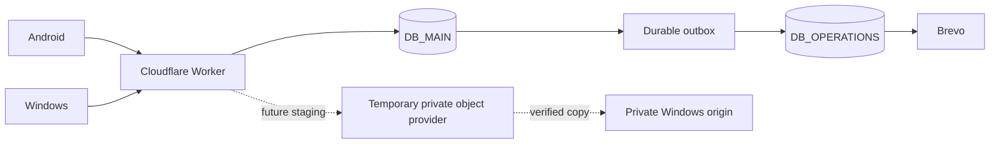

# Architecture

The Flutter apps use HTTPS JSON requests with a shared API client. The Worker checks the account and session on each authenticated request. Its D1 main binding owns identity and business decisions. Its operations binding owns persisted notification, audit and email dispatch records.

Main-database decisions and outbox rows share a same-database transaction. The consumer writes operations records with event IDs as primary keys, then acknowledges the main-database outbox. Retries after either side fails replay the same identifiers safely. No business mutation relies on Brevo or the Windows PC.

The temporary provider must retain files while the PC is offline. Permanent data lives under a configured local origin directory. D1 carries operational metadata only. See [Storage](STORAGE.md).

Flutter uses ChangeNotifier for session state, local widget state for editable forms, and FutureBuilder for data loads. The backend routes use narrow modules, bound SQLite statements, schema validation and allowlisted response projections.
