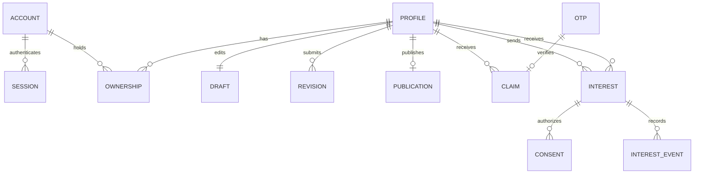

# Database

The Worker targets the existing jain-matrimonial-main (DB_MAIN) and jain-matrimonial-operations (DB_OPERATIONS) databases. See worker/wrangler.toml for their IDs. New table names use the jm_ prefix. Wrangler tracks these migrations separately in jm_migrations on each binding. SQL files define exact column names, types, checks, foreign keys, indexes and triggers.

## Migration inventory

| Binding | Migration | Content |
|---|---|---|
| DB_MAIN | 0001_identity.sql | Accounts, sessions, OTP, rate limits, request replay receipts, outbox |
| DB_MAIN | 0002_profiles.sql | Profiles, ownership, drafts, revisions, claims, publication, moderation triggers |
| DB_MAIN | 0003_matching.sql | Favorites, saved searches, interests and events, consent, privacy, blockers, file metadata |
| DB_MAIN | 0004_moderation.sql | Moderation reasons, audit trigger and privacy request closure |
| DB_MAIN | 0005_admin_password.sql | Singleton Admin verifier, session credential versions and password change audit and revocation triggers |
| DB_OPERATIONS | 0001_operations.sql | Notifications, audit, email delivery jobs, storage jobs |

## Schema relationship overview

| Tables | Business fields and access paths |
|---|---|
| jm_accounts | UUID, normalized email unique, verification timestamp, role and state |
| jm_sessions | UUID, account FK, unique access/refresh hashes, expiry, rotation and revocation |
| jm_otp, jm_rate | Challenge purpose, email, HMAC, expiry, attempts, issue and consumption. Email/purpose index and keyed fixed-window buckets |
| jm_idempotency, jm_outbox | Actor/route/key plus request digest and response receipt. Event ID, actor, entity, action, recipient and processed timestamp. Partial pending index |
| jm_profiles, jm_ownership | Candidate ID, creator, consent/evidence, suspension, visibility and current publication. Ownership joins indexed by account, one owner per profile |
| jm_drafts, jm_revisions | Validated JSON profile and preference documents. Draft version, author, immutable proposed data, base revision, status and reviewer data. Partial one-pending constraint |
| jm_claims | Profile/account/OTP identifiers, review state and reviewer. Unique OTP and one pending claim per profile |
| jm_publication | Current approved snapshot, revision, generated DOB, city, qualification, tradition, height and publication timestamp. Compound city filter plus DOB, height and recent-order indexes |
| jm_favorites, jm_saved_searches | Account-scoped profile links and named normalized filter JSON |
| jm_interests, jm_interest_events | Canonical unique profile pair, sender/recipient, version, expires-at, action and event history |
| jm_consents, jm_consent_events | Verified-email scope, grant and revocation timestamps, participant and interest identifiers |
| jm_blocks, jm_reports, jm_privacy_requests | Account pair with reverse index, abuse report and moderation state, or data request and fulfillment state |
| jm_moderation_actions | Moderator, target, kind, reason and timestamp, indexed by target. Safe action metadata is copied to the audit outbox |
| jm_file_metadata | Opaque ID, candidate, category, SHA-256, MIME, staging provider, access class, copy/retention/deletion state |
| jm_notifications, jm_audit | Cross-database event ID, account or actor, action/entity, timestamp, read state. Per-account and recent indexes |
| jm_email_jobs, jm_storage_jobs | Status, lease/retry metadata, failure reason and retry timestamp, plus file confirmation timestamp for storage |

SQLite comparisons and JSON predicates are parameterized. Age is calculated from DOB against the UTC calendar, including an explicit March 1 birthday boundary in non-leap years for February 29 births. Discovery uses encrypted keyset cursors with deterministic ID tie-breaks and a publication cutoff. Changes to visibility or moderation still apply immediately. Other lists use offset pagination and can shift when records change between requests.

Apply locally from worker with npm.cmd run migrate:local. Before production, verify both live schemas through read-only sqlite_schema queries, inspect migration history and row counts, take approved backups, review table compatibility and reconcile any existing customer records. Cross-database effects use outbox replay instead of a joint transaction.
